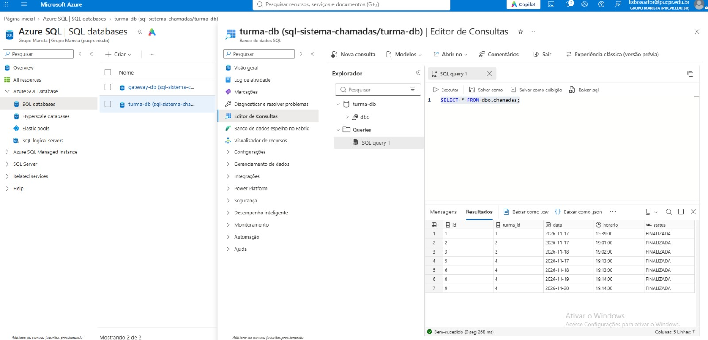
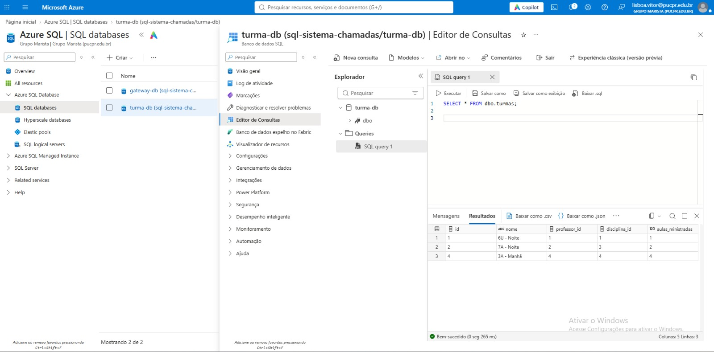
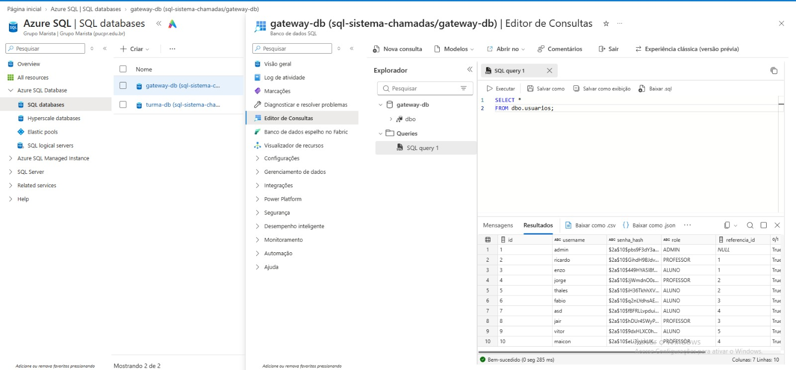
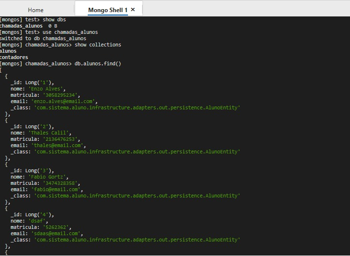

# Sistema de Chamadas - Frontend

> **Vídeo de demonstração do sistema:** https://youtu.be/aqNFj_S9aUA
>
> **Como executar localmente** (frontend, backend e API Gateway): [docs/EXECUCAO_LOCAL.md](docs/EXECUCAO_LOCAL.md)
> · **Arquitetura (arc42):** [docs/arc42.md](docs/arc42.md)

Todas as chamadas de API passam pelo API Gateway (`VITE_API_URL`); o frontend não conhece a URL de nenhum microsserviço.

**Hospedagem:** o frontend é publicado em um **Azure App Service (Node 20)** — o Static Web Apps não está disponível nas
regiões permitidas pela assinatura de estudante. Comando de inicialização do App Service:
`pm2 serve /home/site/wwwroot --no-daemon --spa`. O workflow publica `frontend/host/dist` com o perfil de publicação
(secret `AZURE_PUBLISH_PROFILE_FRONTEND`); a variável `VITE_API_URL` (GitHub > Settings > Secrets and variables >
Actions > Variables) recebe a URL do Gateway e o workflow força `https://`. No Gateway, `FRONTEND_URL` deve ser a URL
deste App Service.

Problemas encontrados: 
1. Ao instalar o vitejs, dava problema de versão por ser a versão mais recente não carregando os módulos ao testar, a solução encontrada foi dar um downgrade de versão nos remotes para 7.3.0 do vite e para 5.1.4 do react. 
2. Ao tentar utilizar o TypeScript como linguagem, havia conflito com o module federation, assim ao usar o federation, o código não entendia o que era o método.

Comandos para atualizar e rodar após alterar:

npm run build:remotes
npm run start

## Frontend - como funciona agora

- **Somente o host é publicado** (App Service). Os 3 microfrontends são compilados e copiados para `host/dist/remotes/<mfe>/assets/` (mesma origem). O deploy falha se algum `remoteEntry.js` não for gerado.
- **Mesma origem**: host e remotos são servidos pelo mesmo endereço, sem CORS entre microfrontends. O `staticwebapp.config.json` do host (CSP) só seria lido pelo Static Web Apps.
- **URL do API Gateway**: variável `VITE_API_URL` em GitHub > Settings > Secrets and variables > Actions > Variables (obrigatória; o build para se ela faltar).
- **Sessão**: o token fica no `sessionStorage`, expira junto com o JWT e qualquer resposta 401 volta para o login.
- **Abas por perfil** (nesta ordem): **Alunos → Chamadas → Usuários**.
  - **ADMIN**: Alunos (consulta de todos, filtro por turma), Chamadas (com **Gerenciar turmas**: disciplinas, turmas e matrículas) e **Usuários** (cadastro unificado de aluno, professor e administrador — o cadastro e o login são criados juntos).
  - **PROFESSOR**: Alunos das suas turmas e Chamadas das suas turmas.
  - **ALUNO**: só a aba Alunos, com os próprios dados e a frequência.
- **Falha de microfrontend**: cada remoto é carregado com novas tentativas e, se falhar, só aquela área mostra o erro (o resto do sistema continua funcionando).

## Execução local

Passo a passo completo (bancos em Docker, Gateway, microsserviços, variáveis, ordem e portas):
[docs/EXECUCAO_LOCAL.md](docs/EXECUCAO_LOCAL.md). Resumo do frontend:

    cd frontend
    npm run install:all
    npm run build:remotes
    npm run start

## Evidências no banco de dados

As capturas abaixo foram tiradas **diretamente nos bancos de dados** do Azure, consultando as tabelas e coleções pelo Editor de Consultas do Azure SQL e pelo Mongo Shell do Cosmos DB. Elas comprovam que os cadastros, turmas e chamadas feitos durante o [vídeo de demonstração](https://youtu.be/aqNFj_S9aUA) foram **persistidos de fato** no banco relacional (**Azure SQL**) e no banco NoSQL (**Azure Cosmos DB for MongoDB**).

**1. Azure SQL — banco `turma-db`, tabela `dbo.chamadas`** (`SELECT * FROM dbo.chamadas`): chamadas criadas e finalizadas, com turma, data, horário (`TIME`) e status `FINALIZADA`.

**2. Azure SQL — banco `turma-db`, tabela `dbo.turmas`** (`SELECT * FROM dbo.turmas`): turmas com professor, disciplina e o contador `aulas_ministradas`, somado a cada chamada finalizada.

**3. Azure SQL — banco `gateway-db`, tabela `dbo.usuarios`** (`SELECT * FROM dbo.usuarios`): logins de administrador, professores e alunos, com senha guardada só como hash BCrypt e `referencia_id` apontando para o professor (turma-service) ou o aluno (aluno-service).

**4. Azure Cosmos DB for MongoDB — banco `chamadas_alunos`, coleção `alunos`** (`db.alunos.find()`): alunos cadastrados pela aba Usuários, com id numérico (`Long`) gerado pela coleção `contadores`.

